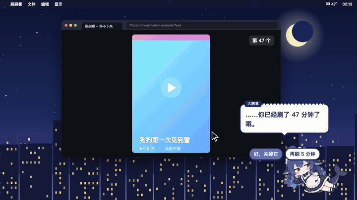
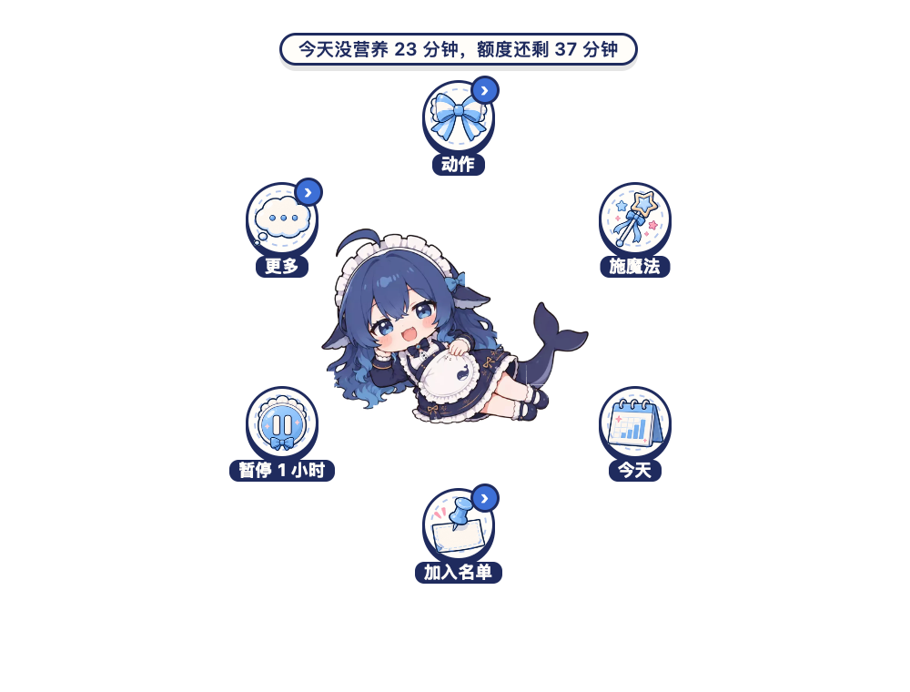
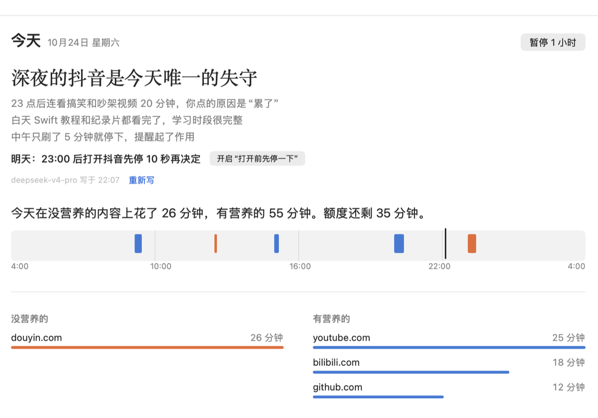

# 鲸醒 WhaleUp

> 凌晨两点，你：“再刷最后一个。” 她：“……你已经刷了 47 分钟了哦。”

一条住在 Mac 屏幕右下角、会施法的大肥鱼。平时陪着你，发现你刷短视频、刷没营养的内容太久了，就冒出来劝你；不听劝？她会飞到浏览器上挥魔杖，“砰”地把网页关掉。



- **记账**：每个网站、每个 App 每天用了多久；晚上刷到凌晨也算在当天（一天从凌晨 4 点开始算）
- **分得清有没有营养**：接上大模型（DeepSeek、Claude、OpenAI 兼容接口或本机 Ollama，用你自己的 Key）后，学习的不打扰，没营养的才管
- **逐级劝导**：气泡提醒 → 倒计时 → 问你为什么在刷 → 强制关闭；劝导文案按你正在看的内容来写
- **强制关闭**：给抖音、B 站这类网站设每天的总时长，刷满就关，当天再打开也关
- **每天写小结、每周写复盘**，可以直接写进 Obsidian
- **陪着你**：饭点吃大米饭、坐久了伸懒腰、你离开就睡着；右键点她，功能围着她转一圈
- **数据都在本机**：银行、支付、邮箱这类网站默认连标题都不记

| 右键点她 | 今天 |
|---|---|
|  |  |

还有 iPhone 版（免费账号就能装：快捷指令自动化 + Safari 扩展），见 [`ios/`](ios/README.md)。

宣传短片的源码在 [`promo/`](promo/)（Remotion 写的，`npm run render` 导出）。

## 它怎么判断

每 5 秒看一次前台在用什么：

- **App**：名字里含“抖音、快手、小红书、微博、哔哩哔哩…”的应用
- **浏览器网址**：Safari / Chrome / Edge / Brave / Arc 当前标签页是不是 douyin.com、bilibili.com、youtube.com/shorts 等

连续刷满 **20 分钟**（夜间 23:00–6:00 为 **5 分钟**）就提醒：

- 点“好，关掉它”：只关掉**当前正在看**的那个网页，浏览器和其他标签页都不动（窗口里只剩这一页时变成空白页）；如果是抖音这类 App 就直接退出
- 点“再刷 5 分钟”：5 分钟后还在刷会再提醒，语气会越来越认真

键鼠 5 分钟没动算人不在，不计时；离开这些内容超过 5 分钟，连续时长清零。

## 强制关闭模式

在菜单里勾选“强制关闭模式”后（默认关闭）：

- 在 `forceCloseSites` 里的网站（默认抖音、快手、B 站、TikTok、YouTube Shorts）上**今天累计**看满 **30 分钟**（按时长统计里的数字，后台播放的视频也算），当前网页会被**直接关掉**，不再询问
- 关之前 1 分钟，右上角会提示一次
- 看满之后，**当天不管什么时候再打开都会被立刻关掉**，不会过一会儿自己放开
- 真要多看，只能去“设置 → 强制关闭”里点“今天再多看 5 / 10 / 30 分钟”，只管当天
- “暂停 1 小时”不会停掉强制关闭，想停只能在菜单里取消勾选

**一天从凌晨 4 点开始算**：4 点以前都算前一天，晚上刷到凌晨不会被拆成两天。统计、每日额度、强制关闭、时间线和小结都按这个算，可以在“设置 → 提醒 → 每天从几点开始算”里改。

所有判断都在本机完成，不联网、不上传任何数据。

## 安装

需要 macOS 13 以上、Xcode（或 Swift 6 工具链）。目前只能从源码编译：

```bash
git clone https://github.com/realyin/whale-up.git
cd whale-up
./scripts/install.sh        # 编译、装到“应用程序”并启动；首次安装自动设为开机启动
./scripts/setup_voice.sh    # 可选：装她的二次元语音（微软在线语音，需要 Python 3）
./scripts/build_safari.sh   # 可选：编译并安装 Safari 扩展
```

然后：

1. 装 Chrome 扩展（记录看了什么内容，AI 判断要用）：见下面的“内容记录”
2. 想用 AI 判断：菜单 →“设置… → AI 判断”，选服务商、填 API Key（存在系统钥匙串里）

菜单栏会出现 🌱（正在刷时变成 👀，后面的数字是今天累计分钟数）。点它选“打开鲸醒”（⌘O），或在“应用程序”里再点一次 App，打开主窗口：

| 页面 | 内容 |
|---|---|
| 今天 | 教练的一句话小结、今天的时长、当天色带（0–24 点每段浏览按有营养 / 没营养着色）、花得最多的网站 |
| 时间线 | 任意一天的色带 + 按小时分组的浏览段落，可删除某天 / 某网站的记录 |
| 内容 | 看过的所有内容，可搜索、按有营养 / 没营养和时间范围筛选，双击在浏览器打开，右键收藏 |
| 收藏 | 收藏的内容和大模型提炼的要点 |
| 趋势 | 近 7 / 30 天有营养 vs 没营养、没营养的主题、钩子、易刷时段、你说的原因 |
| 报告 | 每日小结和每周复盘 |
| 设置 | 网站、App、强制关闭、提醒、内容记录、AI 判断 |

第一次在浏览器里检测时，系统会问“是否允许 WhaleUp 控制 Safari/Chrome”，请点**允许**，否则读不到网址。
构建脚本会优先用本机的 Apple Development 证书签名，这样重新编译后不用再次授权。开机启动可以在菜单里随时关掉。

## 时间线

主窗口的“时间线”页。选一天，看到：

- 0–23 点每小时有营养（🥦 蓝）/ 没营养（🍟 橙）的时长分布，鼠标移上去看具体分钟数
- 按时间排列的浏览段落：连续在同一网站上刷的多条（比如连划 20 个抖音）合成一段，显示“几条 · 多久”，可以展开看每条标题
- 想看到全天所有网页（不只是没营养的），在“设置… → 内容记录”里选“记录所有网页”

## 桌宠

屏幕右下角趴着大肥鱼（默认角色，素材在 `mascot/characters/whale`），代替弹窗做提醒：

- **表情跟着你变**：看学习内容时开心，刷没营养的内容时嘟嘴盯着你，快到时限时皱眉
- **提醒**：在她头顶的气泡里说，并用二次元少女音读出来（微软在线语音“晓伊”，需先运行 `./scripts/setup_voice.sh`；没装或没网时退回系统语音）；“关掉它 / 再刷 5 分钟 / 为什么在刷”都在气泡里。需要写理由的那一级仍用弹窗
- **用法术关网页**：你点“关掉它”、强制关闭到时间、或额度用完时，她会飞到浏览器窗口右上角，挥魔杖放出星星，网页“砰”地关掉，再飞回来
- **小动作**（图片角色有对应的图时）：你离开电脑 5 分钟她就睡着（头顶飘 z），回来时打个哈欠；11:45 和 18:00 到饭点捧着大碗米饭开吃，提醒你去吃饭；连续用电脑 45 分钟伸个懒腰；平时偶尔打哈欠，深夜更频繁
- **右键点她**：功能围着她弹出一圈——动作、施魔法、今天、加入名单、暂停、更多，顶上缎带是今天的概况；点“动作”展开第二圈（吃饭、睡觉、伸懒腰、游泳、跳舞、敲电脑、比心、喝奶茶、看书……，同一个动作有多种姿势随机挑一种），“更多”里是主窗口、设置、强制关闭、隐藏她、退出。也可以按住右键拖到某一项上松开直接选；点她返回上一圈，点别处或按 Esc 收起；靠近屏幕边时圆环变成朝里的一段弧。按住 Option 右键是系统菜单
- 可以拖动她换位置；戳她一下会告诉你今天刷了多久，睡着时戳她会被叫醒
- 在“设置 → 提醒 → 桌宠”里开关、选声音并试听、开关“自动做小动作”（关掉后只在你右键时才做），或点“演示一次施法”

还可以换成 Live2D 官方示例模型 Mao（魔法少女）。它不在仓库里，要先下载（约 5 MB），再在“设置 → 提醒 → 桌宠”里切换：

```bash
./scripts/fetch_mascot.sh   # 下载 Live2D Cubism Core、pixi-live2d-display 和示例模型 Mao
./scripts/install.sh
```

Mao 属于 Live2D 免费素材许可，Cubism Core 属于 Live2D 专有软件许可，只供本机个人使用；分发前请先阅读 Live2D 的许可条款。

想做自己的角色，见 [`tools/character`](tools/character/README.md)。

## 收藏与要点

看到值得留下的内容，收藏它，大模型会提炼一句话概括和 3–5 个要点（用“写报告用的模型”）：

- **正在看的页面**：点 Chrome 工具栏上的扩展图标选“收藏这一页并提取要点”，或按 **⌥⇧S**。文章读正文；B 站在登录状态下读字幕，读不到用简介和标签
- **看过的内容**：在主窗口“内容”页或“时间线”里右键收藏；App 会自己抓网页正文，视频只能用简介
- 在主窗口的“收藏”页查看要点、重新提取或删除；永不记录的网站不能收藏
- 只处理你主动收藏的内容，不会自动提取

## 隐私

- **永不记录的网站**：银行、支付、邮箱、医疗、政务、密码管理等默认在名单里，连标题都不记，时长统计里只显示为“🔒 隐私网站”；可在“设置… → 内容记录”里增删
- **删除记录**：时间线页底部“删除这一天的全部记录”；在时间线或“看过的内容”里右键某一条，可以删除这个网站的所有记录（已写进 Obsidian 的笔记不受影响）
- 全量时间线只在本机；发给大模型的只有判断所需的字段

## 统计

菜单里显示今天没营养内容的时长和额度；详细统计在主窗口的“趋势”和“今天”页：

- **最近 7 天**每天刷没营养内容的时长柱状图，点某根柱子可以看那天的明细
- **每天明细**：每个网站 / App 用了多久，可以切换“没营养的 / 全部”。“全部”里也能看到电脑总使用时长
- 网站按域名统计，命中规则的按规则统计（比如 `youtube.com/shorts` 和其他 YouTube 页面分开算）；其他程序按 App 名统计
- 键鼠 5 分钟没动不计时。保留最近 30 天，数据存在 `~/Library/Application Support/WhaleUp/stats.json`，只在本机
- 规则改了，历史数据会按新规则重新归类：比如把知乎加入没营养网站后，以前在知乎上的时间也会算进去

## 内容记录（Chrome / Safari 扩展）

装上 Chrome 扩展后，会记下看过的每个视频 / 网页：标题、作者、标签、简介、停留时长、视频看了百分之多少。这是后续用大模型分析“为什么刷、刷了什么”的基础（见 [路线图](docs/roadmap.md)）。

- **记录范围**可在“设置… → 内容记录”里选：只记录没营养网站（默认）/ 记录所有网页 / 不记录
- 只要视频在播放就计时：标签页切到后台、窗口最小化或被挡住也算，单独记为“后台播放”；后台静音播放的不算（通常是没人看的自动预览）。没有视频的网页只在前台且 Chrome 是当前窗口时计时
- 劝导弹窗上可以一键记下“为什么在刷”（累了 / 无聊 / 逃避 / 放松）
- 在主窗口的“内容”页查看和搜索
- 数据存在本机 `~/Library/Application Support/WhaleUp/content.sqlite`，保留 90 天；扩展只把数据发到本机 App（`127.0.0.1:47621`），不上传

**安装扩展（只需一次）：** 菜单 →“设置… → 内容记录”，点“打开扩展文件夹”，然后在 Chrome 的 `chrome://extensions` 打开“开发者模式”，点“加载已解压的扩展程序”，选中 `~/Library/Application Support/WhaleUp/ChromeExtension`。App 更新后，在扩展页点一下刷新按钮。

**Safari：** 运行 `./scripts/build_safari.sh`，然后在 Safari →设置→扩展 里勾选“鲸醒 Safari 扩展”并允许访问网站。

已实测：B 站、YouTube、抖音（标题、作者、标签、时长，抖音信息流里每个视频单独一条）。

## AI 判断有没有营养

整个 B 站都在名单里，但 B 站上也有很多学习视频。开启“设置… → AI 判断”后，每条记录下来的内容都会交给大模型判断：

- **有营养**（学习、技术、知识科普等）：不计入没营养时长，不弹窗提醒，不会被强制关闭
- **没营养**（娱乐、搞笑、八卦等）：照常提醒、照常强制关闭；名单外的网站被判没营养也会提醒（需要“记录所有网页”）
- 还没判断出来时（新视频的前十几秒），按网站规则处理
- “你的标准”可以用自己的话写什么算有营养，会原样写进提示词
- 服务商可选 Anthropic（默认用 `claude-haiku-5-5` 判断）、DeepSeek（默认 `deepseek-flash`）、任意 OpenAI 兼容接口、本机 Ollama（内容不出电脑）
- API Key 存在系统钥匙串里；每条内容只发送网站名、标题、作者、标签、简介和视频时长，不发完整网址和观看时间；同一条内容只判断一次
- 判断结果显示在主窗口的“内容”页；菜单和时长统计里，名单内被判有营养的时长单独记为“xx · 有营养”

前提：需要开启内容记录并安装浏览器扩展。

## 每日小结与每周复盘

开启 AI 判断后，用“写报告用的模型”：

- **每日小结**：每天到点（默认 22:00）自动写当天的：一句话结论 + 最多 3 条发现 + 明天一个行动；漏写的前一天会补上
- **每周复盘**：每周一自动写上一周的：结论、最多 3 条规律、有依据的原因、最多 2 条行动、有营养的替代、下周承诺
- 只写洞察，不复述界面上已有的数字，不猜测心理；在主窗口的“今天”和“报告”页查看，也可以手动写 / 重写
- 同时写进 Obsidian：自动找到当前的库，存到 `鲸醒/每日小结/`、`鲸醒/每周复盘/`；可在“AI 判断”设置里改文件夹或关闭

## 劝导怎么越来越管用

- **AI 写劝导**：弹窗文案由大模型结合你刚才看的具体内容、时间、你说过的原因来写；4 秒拿不到就用固定文案
- **记住效果**：每次劝导你是“关掉它”还是“再刷”都会记下；下次写劝导时告诉大模型哪种说法对你有效
- **逐级加强**：第二次提醒起“再刷”要等 10 秒；第三次起或额度用完后还要写一句理由（理由也会进入小结和复盘）
- **打开前先停一下**（可选）：从正常内容切到没营养的内容时，先深呼吸几秒再决定
- **每日额度**：一天最多刷多少分钟，用完再刷 1 分钟就提醒，也可以设为用完直接关网页
- **工作时段**：可选星期和时间，期间连续刷几分钟就提醒

## 修改规则

**最快的方法：** 在浏览器里打开想管的网站，点菜单栏 🌱 →“把 xxx.com 加入…”，再选“没营养网站”或“强制关闭网站”。

**设置页：** 菜单 →“设置…”（⌘,）：

- **网站 / App**：没营养的网站和 App 列表。顶部会显示浏览器当前网页，点“添加这个网站”就能加进去；也可以直接粘贴网址（会自动只保留域名），或手动输入 `youtube.com/shorts` 这样带路径的规则。选中后按删除键或点“删除所选”可以移除
- **强制关闭**：开关、每天累计多久关闭、今天已看多久和“今天再多看”，以及强制关闭的网站列表
- **提醒**：白天/夜间提醒时长、夜间时段、每日额度、工作时段、逐级加强
- **内容记录**：记录范围、扩展安装
- **AI 判断**：开关、你的标准、服务商与模型、API Key、AI 劝导、小结时间、Obsidian

改动立即生效。所有设置保存在 `~/Library/Application Support/WhaleUp/config.json`，也可以直接编辑这个文件。

## 开发

```bash
swift test                                   # 规则与计时逻辑的单元测试
WHALEUP_DEBUG=1 build/WhaleUp.app/Contents/MacOS/WhaleUp   # 在终端打印每次检测结果
WHALEUP_RENDER_NUDGE=/tmp build/WhaleUp.app/Contents/MacOS/WhaleUp  # 把弹窗渲染成 PNG
WHALEUP_RENDER_SETTINGS=/tmp build/WhaleUp.app/Contents/MacOS/WhaleUp  # 把设置页渲染成 PNG
WHALEUP_RENDER_MAIN=/tmp build/WhaleUp.app/Contents/MacOS/WhaleUp      # 用示例数据把主窗口每一页渲染成 PNG
WHALEUP_CLOSE_JUNK=com.google.Chrome build/WhaleUp.app/Contents/MacOS/WhaleUp  # 关掉当前标签页（若在没营养的网站上）
WHALEUP_TEST_LABEL=1 build/WhaleUp.app/Contents/MacOS/WhaleUp    # 用当前配置判断两条示例（会调用大模型）
WHALEUP_TEST_NUDGE=1 build/WhaleUp.app/Contents/MacOS/WhaleUp    # 按最近记录写一条劝导（会调用大模型）
WHALEUP_WRITE_DIGEST=1 build/WhaleUp.app/Contents/MacOS/WhaleUp  # 立刻写今天的小结（会调用大模型）
WHALEUP_WRITE_WEEKLY=1 build/WhaleUp.app/Contents/MacOS/WhaleUp  # 立刻写本周复盘（会调用大模型并写入 Obsidian）
WHALEUP_TEST_FAVORITE=<网址> build/WhaleUp.app/Contents/MacOS/WhaleUp  # 抓网页并提炼要点（临时数据库，会调用大模型）
WHALEUP_MASCOT_DEMO=/tmp build/WhaleUp.app/Contents/MacOS/WhaleUp  # 单独显示桌宠，截图各表情、气泡、施法
WHALEUP_MASCOT_SEQ=dance WHALEUP_MASCOT_DEMO=/tmp build/WhaleUp.app/Contents/MacOS/WhaleUp  # 只演一个动作，连拍 16 张检查是否连贯
```

代码结构：`Sources/WhaleUpCore` 是纯逻辑（分类、计时、文案），`Sources/WhaleUp` 是菜单栏 App（系统监测、弹窗）。

## 已知限制

- Firefox 不支持读取网址，只能按 App 判断
- AI 判断、小结只覆盖装了扩展的浏览器；抖音等桌面 App 只按名字判断
- iPhone 版刚开始，见 [`ios/`](ios/README.md)；安卓还没有

## 从「专注守护 / FocusGuard」升级

旧版本叫专注守护（FocusGuard.app）。运行 `./scripts/install.sh` 会退出并删掉旧 App；新版第一次启动时，把数据目录从 `~/Library/Application Support/FocusGuard` 搬到 `WhaleUp`（旧路径留一个替身，已经加载的 Chrome 扩展照常能用），计时状态、桌宠位置也会搬过来。之后：

- 系统会重新问一次“是否允许鲸醒控制 Chrome / Safari”，点允许
- 第一次用到 AI 判断时，钥匙串会问能否读取旧的 API Key，点“始终允许”
- 开机启动要在菜单里重新勾一次
- Chrome 扩展：在 `chrome://extensions` 里点一下刷新

## 许可

代码以 [MIT 许可证](LICENSE) 开源。

素材说明：

- 角色“大肥鱼”（`mascot/characters/whale`）和右键圆环的图标由 AI 绘图生成，形象参考了 DeepSeek 的鲸鱼；这是同人形象，与 DeepSeek 官方无关
- `mascot/lib/pixi.min.js` 是 [pixi.js](https://pixijs.com) 6.5.10，MIT 许可
- Live2D 相关文件（Cubism Core、模型 Mao）不在仓库里，由 `scripts/fetch_mascot.sh` 下载，适用 Live2D 自己的许可
- 她的声音用的是微软 Edge 在线语音（通过 [edge-tts](https://github.com/rany2/edge-tts)），需要联网
